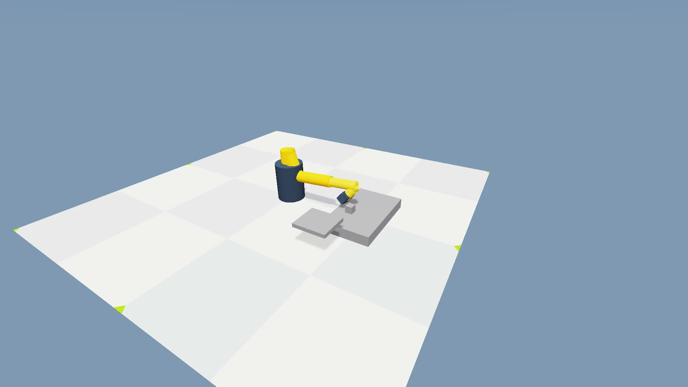
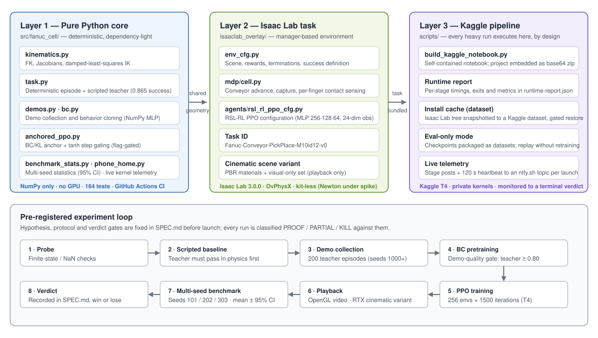

# FANUC Conveyor Pick-and-Place

[](https://github.com/santleme/fanuc-nvdia/actions/workflows/ci.yml)

**A spec-driven virtual industrial cell: a 6-axis robot arm intercepts parts on a moving conveyor, grasps them, and places them in a target zone — built to be trained, measured, and proven (or disproven) by pre-registered experiments on Kaggle GPUs.**



## What this is

This repository designs, builds, and stress-tests a simulated conveyor pick-and-place cell inspired by the **FANUC M-10iD/12** (6 axes, 12 kg rated payload, 1,441 mm reach, ±0.02 mm published repeatability — [FANUC America](https://www.fanucamerica.com/products/robot/m-10id-12)).

An honesty note up front: the robot in this project is a **declared approximate proxy** — link dimensions and inertias are configured approximations, not official FANUC CAD, and nothing here is a dynamics-validated digital twin. What *is* rigorous is the process around it: every experiment is specified in [SPEC.md](SPEC.md) **before** it runs, with explicit pass/fail gates, and every verdict — including the negative ones — is recorded there.

The cell's task is deliberately unforgiving. A part advances on the belt at a randomized speed; success requires bilateral finger contact, a closed gripper, a lift, and a release inside a 12 cm place zone. There is no partial credit in the headline metric.

## Architecture



The system is built in three layers, so that everything that can be tested without a GPU is:

1. **Pure Python core** (`src/fanuc_cell/`) — NumPy only. Forward kinematics, Jacobians, and damped-least-squares IK for the arm proxy; a deterministic episode model and a **scripted teacher** that executes the full home → approach → grasp → hold → lift → transfer → release cycle (0.865 task success, 0.92 grasp rate under collection conditions); demo collection and behavior cloning; statistics and telemetry helpers. This layer carries the project's unit-test suite and runs in CI on every push.
2. **Isaac Lab overlay** (`isaaclab_overlay/`) — the manager-based task `Fanuc-Conveyor-PickPlace-M10id12-v0` on **Isaac Lab 3.0.0**, kit-less, with OvPhysX physics: scene and reward configuration, MDP terms (conveyor advance, two-stage capture, per-finger filtered contact sensors), and the **RSL-RL PPO** agent configuration. The policy sees a 24-dimensional observation (8 joint positions, 8 joint velocities, part position relative to the TCP, part velocity, 2 finger contact forces) and acts through an MLP [256, 128, 64].
3. **Kaggle execution pipeline** (`scripts/`) — all training and simulation run on Kaggle T4 GPUs, by design; nothing heavy runs on a development machine. A builder generates a **self-contained notebook** (the project source is embedded as a base64 zip), pushes it, and monitors it to a terminal state. Each run emits a structured `runtime-report.json` with per-stage timings, exit codes, and metrics.

## Engineering features

| Feature | What it does |
|---|---|
| **Pre-registered protocols** | Hypothesis, budget, and verdict gates (PROOF / PARTIAL / KILL) are written into SPEC.md before launch. Runs that miss the protocol are invalid as evidence, however green their pipeline is. |
| **Multi-seed benchmark (B3)** | Policies are scored on seeds 101 / 202 / 303; the reported success rate is the mean with a 95% confidence interval and per-seed grasp rates — single-seed verdicts are not accepted. |
| **Eval-only mode (B2)** | A trained checkpoint is packaged as a Kaggle dataset (with a sha256 manifest) and replayed — playback + benchmark — without retraining, always by explicit path, never by "latest". |
| **Isaac Lab install cache (B4)** | The Isaac Lab tree is snapshotted into a Kaggle dataset by a builder kernel; consumer kernels restore it behind a three-layer gate with automatic fallback to a full install. |
| **Cinematic RTX playback** | A builder flag switches *only* the playback to the OVRTX path tracer (`newton_rtx`) with a PBR scene variant — structured belt, safety stripe, fence, key light, cinematic camera — over byte-identical physics, training, and benchmark code. |
| **Live kernel telemetry** | Kaggle publishes no logs while a kernel runs, so kernels phone home: boot, per-stage completion, and a 120 s heartbeat to a per-launch ntfy.sh topic that the monitor reads in real time. Opt-in per launch; the default notebook is unchanged. |
| **CI on the pure core** | GitHub Actions runs the structural suite — **165 tests**, Python 3.12, numpy + pytest only, no Isaac Lab, no GPU — on every push and pull request. |
| **Rerun rollout logging** | Optional `--rerun` flags record rollouts for visual diagnosis; without the SDK installed the logger is a no-op. |

## Experiment log — honest verdicts

The full record, with protocols and evidence, is in [SPEC.md](SPEC.md). The headline results so far are negative, and they are the most valuable output of the project to date:

| Run | Question | Verdict |
|---|---|---|
| **Pure PPO (v70)** | Can PPO discover the grasp from staged rewards + a belt curriculum? 256 envs × 1500 iterations, 9.2 M samples. | **KILL.** Success 0.0; `grasp_contact` was 0.0 in every logged window — the grasp conjunction (closed gripper ∧ bilateral contact ∧ part held) was never discovered, even with a stationary target. Pure PPO was retired as a direction. |
| **BC warm-start (v7)** | Does cloning the scripted teacher (200 demos, gate ≥ 0.80; teacher scored 0.865) put PPO inside the grasp region from iteration 0? | **KILL.** The full chain ran cleanly — collection, BC training, warm-started PPO to `model_1499`, playback, benchmark — and still scored **0.0**. The warm start did not survive contact with PPO. |
| **Experiment 1 (issue #8)** | Was the clone destroyed by PPO (forgetting), or was the clone itself weak? Stage A evaluated the **pure BC actor** for 200 episodes on fresh seeds (2000+); Stage B re-ran PPO with a protected start (zero entropy, critic warmed up 50 iterations with the actor frozen). | **The clone is condemned.** Stage A: success 0.0, **grasp 0.0** — the cloned policy does not express the grasp outside its demo distribution. Stage B's multi-seed benchmark: [0, 0, 0]. This rules out "PPO erased a good clone" as the primary explanation and redirects the work (below). |
| **Newton physics spike (issue #2)** | Can the MuJoCo-Warp backend (`newton_mjwarp`) replace OvPhysX? Pre-registered gates: conversion + finite probe, then the scripted baseline must complete under Newton contact physics. | **Inconclusive — not an engine failure.** Gate 0 passed (finite probe, 64 envs). Gate 1 failed twice: the baseline never achieved closed bilateral contact (0 steps; finger force peaks 63.6 N vs 250.8 N; the part is ejected). Two of the ≤ 3 pre-registered contact retunes are merged (elliptic friction cone + `impratio` 10; multi-CCD manifolds + capacities); the spike continues. |
| **Anchored PPO (Exp. 3, issue #23)** | Does a decaying BC/KL anchor during PPO prevent forgetting (the DAPG/RFT recipe)? | **Implemented behind flags, deliberately not launched.** Per the pre-registered decision tree, Experiment 1's outcome (clone condemned) deprioritizes anchoring a weak clone; the code waits for a BC worth anchoring. |

Supporting studies: the [observability/memory study](docs/estudo-observabilidade-2026-10-27.md) (issue #8 — ranked the failure hypotheses and designed Experiment 1 and the OBS-2 frame-stacking variant, H = 8, merged behind a flag) and the [external integration audit](docs/auditoria-integracoes-2026-10-27.md) (why there is no plug-and-play BC→RL library for this stack, and what was adopted or rejected, with licenses checked).

## Repository layout

```text
src/fanuc_cell/        Pure core: kinematics, task/teacher, demos, BC, anchored PPO,
                       benchmark stats, install cache, gripper threshold, telemetry
isaaclab_overlay/      Isaac Lab 3.0 task: env_cfg, MDP terms, RSL-RL PPO config
scripts/               Notebook builders, Kaggle push/status tools, training and
                       evaluation entry points, cache builder, checkpoint packaging
tests/                 Structural suite for the pure core (165 tests, CI)
spikes/                Self-contained spike notebooks (e.g. cuRobo V2 install/IK probe)
kaggle/                Generated kernel notebook + metadata (builder output)
SPEC.md                Specification, protocols, and every recorded verdict
docs/                  Audits, studies, and design notes
```

## Quickstart

**Pure core (any machine, no GPU):**

```bash
python3 -m pip install -e '.[dev,video]'
PYTHONPATH=src pytest -q
PYTHONPATH=src python3 scripts/render_demo.py --output outputs/fanuc-cell-demo.mp4
```

**Full runs (Kaggle, by design):** training, physics, and rendering never run on a development VM in this project. Build the self-contained notebook, push it, and watch it to its terminal state:

```bash
python3 scripts/build_kaggle_notebook.py --kaggle-user <your-kaggle-user>
python3 scripts/kaggle_push_kernel.py --usuario <your-kaggle-user>
python3 scripts/kaggle_kernel_status.py --slug fanuc-conveyor-pick-place --log-tail
```

Builder flags select the experiment: `--bc-warmstart` (teacher demos + BC + warm-started PPO), `--bc-exp1` (Experiment 1 diagnostics), `--bc-anchor` (anchored PPO), `--obs-history 8` (OBS-2), `--cinematic-video` (RTX playback), `--eval-only --eval-checkpoint <dataset>/<file>.pt` (checkpoint replay), `--isaac-cache-dataset <user>/<dataset>` (install cache), and `--phone-home-topic <topic>` (live telemetry). With no experiment flags, the generated notebook is the standard pipeline — several flag combinations are pinned byte-identical by tests.

## Status and next steps

- **Learning direction (post–Experiment 1):** expand what the clone can see and teach it where it fails — richer state and DAgger-style collection with the scripted teacher relabeling student-visited states — before spending more GPU on PPO variants. The anchored-PPO implementation stays ready behind its flags.
- **Newton spike:** gate 1 (bilateral contact under MuJoCo-Warp) is still open, with pre-registered contact retunes in flight; OvPhysX remains the production physics line meanwhile.
- **Cinematic video:** the RTX playback code is merged; the remaining acceptance step is the Kaggle smoke/proof run (OVRTX on T4, measured render time) per the protocol in SPEC.md.
- **Infrastructure acceptance runs:** the install-cache activation (builder run → dataset → first restored run), the eval-only verification flight, and the gripper-threshold measurement probe are implemented and queued behind Kaggle GPU availability.

## Documentation

- [SPEC.md](SPEC.md) — specification, pre-registered protocols, and all verdicts
- [docs/estudo-observabilidade-2026-10-27.md](docs/estudo-observabilidade-2026-10-27.md) — observability/memory study (issue #8)
- [docs/auditoria-integracoes-2026-10-27.md](docs/auditoria-integracoes-2026-10-27.md) — external projects audit (integrate / spike / reject, with licenses)
- [docs/audit-video-cena-2026-10-27.md](docs/audit-video-cena-2026-10-27.md) — video/scene audit behind the cinematic playback
- [docs/isaac-cache.md](docs/isaac-cache.md) — Isaac Lab install-cache design
- [docs/backlog-pos-v68.md](docs/backlog-pos-v68.md) — post-v68 backlog and dispositions

## License

No license has been chosen for this repository yet. Until one is added, the code is **all rights reserved** by default — please do not reuse it under the assumption of an open-source license.
